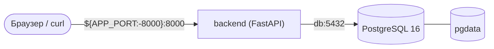

# Схема окружения проекта

**Команда:** Команда А
**Проект:** SurveyGuard — система анкетирования с автоматической ML-фильтрацией выбросов, ботов и недобросовестного заполнения.
**Дата:** 2026-11-19

## 0. Кто что делал

| Участник | Роль на воркшопе | Что конкретно сделал |
|---|---|---|
| Волков Михаил | Архитектор схемы | Нарисовал схему сервисов, определил порты, тома и зависимости |
| Иван Савчук | Ведущий таблицы сервисов | Заполнил таблицу сервисов, проверил имена переменных окружения и healthcheck |
| Елизавета Тропина | Автор ADR 002 | Готовит ADR 002 в отдельной ветке `docs/adr-002-dependency-manager` |
| Иван Савчук | Рецензент (проверяет схему другой команды) | Отвечает за рецензирование схемы закреплённой команды по чек-листу раздела 4 |

## 1. Схема

Сервисы SurveyGuard в сети Docker Compose:

## 2. Таблица сервисов

| Сервис | Образ или сборка | Порты `хост:контейнер` | Переменные окружения (только имена, без значений) | Тома | Зависит от (условие) | Healthcheck |
|---|---|---|---|---|---|---|
| `app` | build: `.` (Dockerfile, `python:3.11-slim`) | `${APP_PORT:-8000}:8000` | `DATABASE_URL` | — | `db` (`service_healthy`) | `curl -f http://localhost:8000/health` |
| `db` | `postgres:16` | не публикуется, внутри сети `5432` | `POSTGRES_DB`, `POSTGRES_USER`, `POSTGRES_PASSWORD` | `pgdata:/var/lib/postgresql/data` | — | `pg_isready -U $POSTGRES_USER -d $POSTGRES_DB` |

Порт приложения `${APP_PORT:-8000}` опубликован для браузера и `/docs`; порт БД наружу не публикуется — к нему обращается только `app` внутри сети Compose. `frontend` и ML-сервис в практику №3 не входят и в `compose.yaml` не добавляются.

Порт хоста приложения вынесен в переменную `${APP_PORT:-8000}:8000` — тот, у кого 8000 занят, сменит его в своём `.env`.

## 3. Ответы на контрольные вопросы

1. **Адрес базы.** Приложение подключается к БД по адресу `postgresql://surveyguard@db:5432/surveyguard`. Полная строка подключения вместе с паролем передаётся в переменной `DATABASE_URL`.
2. **Судьба данных.** После `docker compose down` именованный том `pgdata` сохраняется, данные БД остаются на месте. После `docker compose down -v` том удаляется вместе с данными.
3. **Образ и запуск.** В образ приложения попадают исходный код, runtime Python и зависимости, зафиксированные lock-файлом uv/Poetry. При запуске контейнера передаются переменные окружения (включая `DATABASE_URL`), опубликованные порты, тома и команда запуска. Файл `.env` в образ не копируется.
4. **Миграции.** Гипотеза: при старте контейнера `app` entrypoint выполняет `alembic upgrade head`, после чего запускает `uvicorn`. Альтернатива — отдельный one-shot сервис `migrate` с `depends_on: db: condition: service_healthy`. Проверяется на практике №3.
5. **Запуск и проверка.** Поднять стек: `docker compose up --build -d`. Проверить: `curl -fsS "http://localhost:${APP_PORT:-8000}/health"` — ожидаемый ответ `{"status":"healthy","database":"ok"}`; без базы — `503`. Дополнительно `docker compose ps` показывает запущенные сервисы.

## 4. Проверка схемы другой командой

**Команда-рецензент:** [Команда B]
**Рецензент:** [Егор Мокрецов, @EgorMokretsov]

### Чек-лист

| № | Критерий | Где смотреть | Оценка | Комментарий |
|---|---|---|---|---|
| 1 | В стеке есть приложение и PostgreSQL; каждый дополнительный сервис обоснован | Раздел 2: строки сервисов; у каждого сверх двух — фраза «зачем» | ✅ | Раздел 2: в таблице ровно два сервиса — `app` и `db`. Дополнительных сервисов нет, обосновывать нечего |
| 2 | Версия образа БД зафиксирована (не `latest` и не без тега) | Раздел 2, строка БД, колонка «Образ»: после двоеточия — конкретная версия | ✅ | Раздел 2, строка `db`: указан образ `postgres:16`, тег зафиксирован |
| 3 | Приложение обращается к БД по адресу, который работает **внутри** сети Compose | Раздел 3, вопрос 1: хост в строке подключения сравнить с именами сервисов в разделе 2 | ✅ | Раздел 3, вопрос 1: `postgresql://surveyguard@db:5432/surveyguard`. Хост `db` совпадает с именем сервиса БД в разделе 2 |
| 4 | Данные БД хранятся в именованном томе, путь монтирования соответствует версии PostgreSQL | Раздел 2, строка БД, колонка «Тома»: у тома есть имя; путь сверить с версией образа по описанию образа postgres (раздел PGDATA) | ✅ | Раздел 2, строка `db`: том `pgdata:/var/lib/postgresql/data`. Для `postgres:16` это корректный путь PGDATA |
| 5 | Приложение стартует только после того, как БД готова (условие в зависимости + healthcheck у БД) | Раздел 2: у приложения колонка «Зависит от» — с условием; у БД колонка «Healthcheck» заполнена | ✅ | Раздел 2: у `app` зависимость `db (service_healthy)`, у `db` healthcheck `pg_isready -U $POSTGRES_USER -d $POSTGRES_DB` |
| 6 | Наружу опубликованы только нужные порты; для каждого опубликованного порта понятно, зачем | Раздел 2, колонка «Порты»: для каждого порта — кто к нему ходит снаружи | ✅ | Раздел 2: опубликован только порт `app` `${APP_PORT:-8000}:8000` — для браузера и `/docs`. У `db` порт наружу не публикуется |
| 7 | Переменные окружения перечислены по именам, значений секретов в схеме нет | Раздел 2, колонка переменных; раздел 3, вопрос 1: нигде нет паролей | ✅ | Раздел 2: у `app` только `DATABASE_URL`, у `db` — `POSTGRES_DB`, `POSTGRES_USER`, `POSTGRES_PASSWORD`. Значений и паролей в схеме нет; в разделе 3 строка подключения без пароля |
| 8 | Есть ответ, как создаётся схема БД при первом запуске | Раздел 3, вопрос 4 (гипотеза допустима) | ✅ | Раздел 3, вопрос 4: указана гипотеза `alembic upgrade head` при старте `app`. Слово «гипотеза» есть, для практики №3 это допустимо |
| 9 | Стек поднимается одной командой, есть проверяемый признак успешного запуска | Раздел 3, вопрос 5: команда и что именно проверить после неё | ✅ | Раздел 3, вопрос 5: `docker compose up --build -d`, проверка `curl .../health` → `{"status":"healthy","database":"ok"}`, без базы — `503` |

**Главные замечания** — до двух, по формуле «где → что не так → чем грозит → что предлагаете». Если блокирующих проблем нет, напишите вместо них: «Блокирующих замечаний нет».

1. Блокирующих замечаний нет.
2. —

**Холодное чтение.**

- По схеме можно написать `compose.yaml` без вопросов: есть имена сервисов, образы, порты, переменные, том, healthcheck и условие запуска. Для холодного запуска не хватает только явной команды копирования `.env.example` → `.env` в README — это вынесено в рекомендацию ниже.

**Рекомендация или вопрос** за пределами чек-листа:

- В README для практики №3 добавить первым шагом `cp .env.example .env` (PowerShell: `Copy-Item .env.example .env`) и проверку `/health` после `docker compose up --build`. На схему это не влияет, но уменьшит число вопросов при проверке другой командой.

## 5. Что изменено по замечаниям

| Замечание или рекомендация | Что изменили, почему не согласны или учтёте ли рекомендацию |
|---|---|
| Блокирующих замечаний нет | Схему менять не потребовалось: состав сервисов, порты, том, переменные и порядок запуска уже соответствуют будущему `compose.yaml` |
| Добавить в README команду `cp .env.example .env` и проверку `/health` | Рекомендацию принимаем. Добавим эти шаги в раздел README «Запуск через Docker Compose» при выполнении практики №3; на схему это не влияет |

